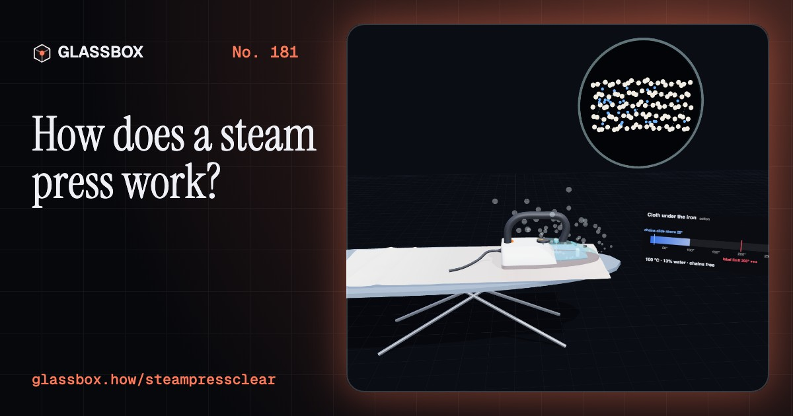
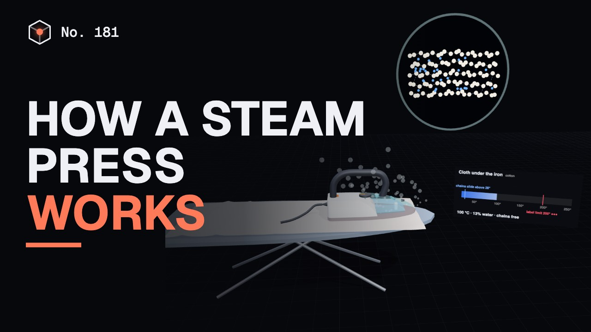
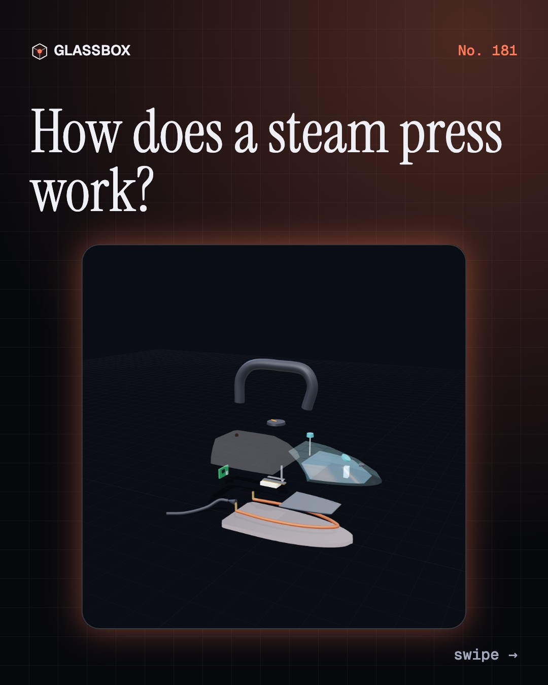
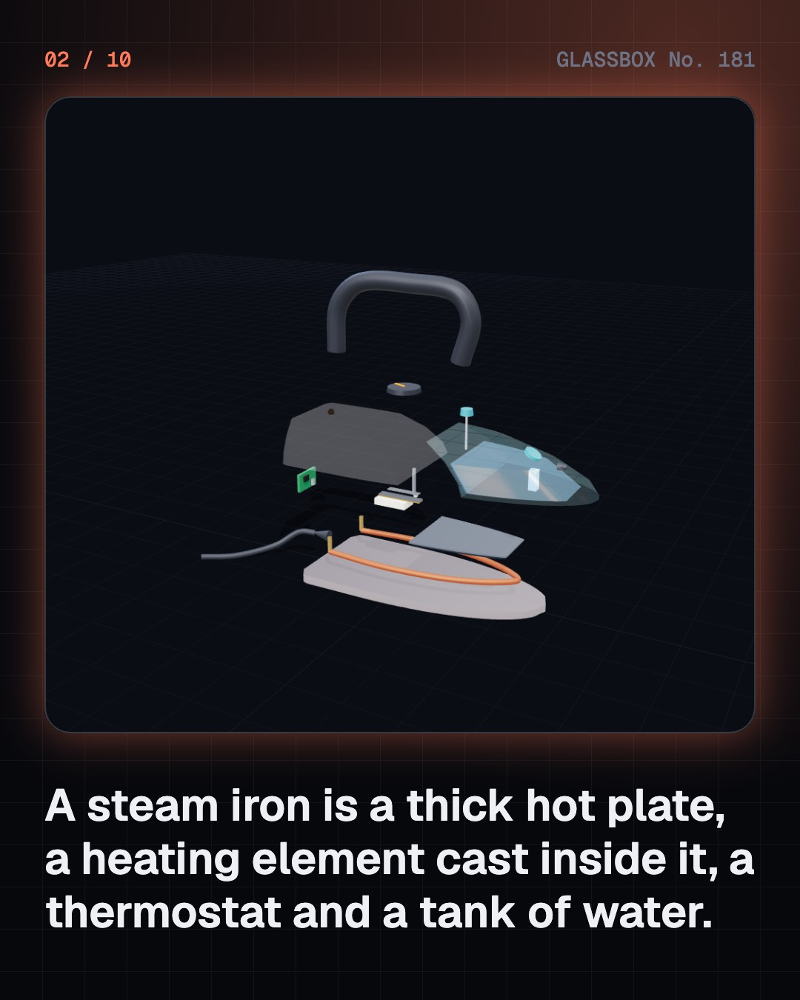
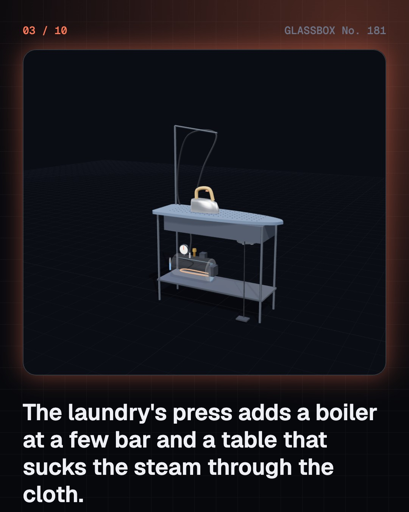
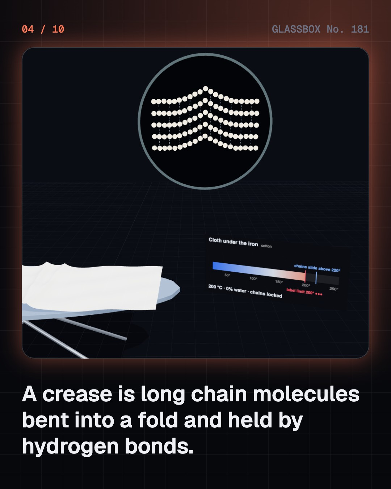

<!-- glassbox:start -->
<!-- Generated from glassbox.json by the Glassbox hub (npm run readme -- steampressclear). Edit glassbox.json, not this block. -->
<p align="center"><a href="https://glassbox.how/e/steampressclear/"></a></p>

<h1 align="center">SteamPressClear</h1>

<p align="center"><b>How does a steam press work?</b><br>Two thousand watts into a thick metal plate, a strip of two metals that clicks it on and off, and a few drops of water that flash into steam. Take an iron apart in 3D, see why steam unlocks a crease, and meet the laundry's boiler press and the istri-wala's charcoal iron.</p>

<p align="center"><a href="https://glassbox.how/steampressclear/"><b>▶ Play with it</b></a> &nbsp;·&nbsp; <a href="https://glassbox.how/e/steampressclear/">Read the 60-second explainer</a> &nbsp;·&nbsp; <a href="https://glassbox.how/steampressclear/glassbox/reel.mp4">Watch the 40-second video</a></p>

<p align="center">
  <a href="https://glassbox.how/e/steampressclear/"></a>
  <a href="https://glassbox.how/e/steampressclear/"></a>
  <a href="LICENSE"></a>
  <a href="LICENSE-CONTENT.md"></a>
  <a href="#privacy"></a>
</p>

## In 60 seconds

1. **A hot plate, a thermostat and some water.** A steam iron is a thick aluminium or steel soleplate with a heating element cast inside it, a bimetal thermostat under the dial, and a water tank whose drip valve lets drops fall into a steam chamber on the hot plate. At 2,000 W it draws about 8.7 A from a 230 V socket.
2. **Steam unlocks the crease.** Cotton and wool chains are held in a fold by hydrogen bonds. Water slips between the chains and heat lets them slide above their glass transition; the iron's weight presses them flat. As the cloth cools and dries, the bonds re-form and lock the flat shape in. Polyester needs only heat, but melts if it is too hot: hence the care label's one, two or three dots, up to 110, 150 and 200 °C.
3. **The heat sums.** The soleplate stores about 620 J per degree, so 2,000 W brings it to 200 °C in about a minute. A brass-on-invar strip curls about 2 mm as it warms and clicks the element off and on. Turning tap water into steam takes about 2,550 J a gram, so a 2,000 W iron has heat to spare for only about 40 g of steam a minute.
4. **The laundry's boiler press.** A small boiler at 4 bar holds water at about 152 °C. Its steam blasts out about 1.5 g a second, arrives hotter than 100 °C and dry, and the hot water stores enough heat to flash into about 100 g of steam per litre. A pressure switch, a gauge, a sight glass and a safety valve keep it in check, and a vacuum table pulls the steam through the cloth and then cools it in seconds.
5. **The istri-wala's charcoal iron.** Five kilograms of cast iron store about 2,300 J per degree, so the istri-wala's box iron stays hot between loads of charcoal; blowing on the coals gives them more air and more heat. Burning charcoal makes carbon monoxide, so it must never be used in a closed room.
6. **Safe and lasting.** A gram of steam condensing on skin gives about ten times the heat of a gram of boiling water. Never leave an iron face-down, switch off and unplug when you step away and before filling, use an earthed socket, and never tamper with the thermostat, thermal fuse or auto shut-off. Hard water leaves limescale that clogs the steam holes.

## Words worth knowing

| Term | Meaning |
|---|---|
| **Soleplate** | The flat metal bottom of an iron that touches the cloth, with the heating element cast into it. |
| **Thermostat** | A switch, here a bimetal strip, that turns the heater off when hot enough and on again as it cools. |
| **Bimetal strip** | Two metals bonded together that expand by different amounts, so the strip bends when heated. |
| **Latent heat** | The heat that turns water into steam without changing its temperature: about 2,257 J for each gram. |
| **Hydrogen bond** | A weak pull between neighbouring molecules; in cotton and wool it holds the chains in shape. |
| **Glass transition** | The temperature above which a solid's long chains can slide, so it softens and can be reshaped. |
| **Gauge pressure** | Pressure above the air outside, the number on a boiler's pressure gauge. |
| **Safety valve** | A valve that opens by itself if a boiler's pressure climbs past its limit. It must never be tampered with. |
| **Carbon monoxide** | A poisonous gas with no colour or smell, made whenever charcoal or other fuel burns. |

## A short history

**Two thousand years from a pan of hot coals to a solar ironing cart.**

- **100 BCE** · Pans of hot coals smooth cloth (Unknown makers, China)
- **1600** · The sad iron (Blacksmiths and households, Europe and North America)
- **1871** · A cool, detachable handle (Mary Florence Potts, Ottumwa, Iowa)
- **1882** · The electric flatiron is patented (Henry W. Seely, New York)
- **1890** · Mumbai's Dhobi Ghat is built (Dhobis of Bombay, Mahalaxmi, Mumbai)
- **1904** · A steam pressing machine for tailors (Hoffman Pressing Machine Company, Syracuse, New York)
- **1905** · The iron with the hot point (Earl H. Richardson, Ontario, California)
- **1926** · The first steam iron on sale (Eldec, New York)

The full story, with 22 moments, charts, people and 21 sources: [glassbox.how/e/steampressclear/history](https://glassbox.how/e/steampressclear/history/). The data lives in [`history.json`](history.json).

## Video and slides

Made with the Glassbox studio from this box's storyboard (`window.glassbox.director`). Free to reuse under CC BY 4.0.

<a href="https://glassbox.how/steampressclear/glassbox/video.mp4"></a>

<p><a href="glassbox/slide-1.jpg"></a> <a href="glassbox/slide-2.jpg"></a> <a href="glassbox/slide-3.jpg"></a> <a href="glassbox/slide-4.jpg"></a></p>

| File | What | Size |
|---|---|---|
| [`glassbox/reel.mp4`](https://glassbox.how/steampressclear/glassbox/reel.mp4) | Reel / Short, with captions and soundtrack | 1080×1920 |
| [`glassbox/video.mp4`](https://glassbox.how/steampressclear/glassbox/video.mp4) | YouTube video, with captions and soundtrack | 1920×1080 |
| `glassbox/slide-1…10.jpg` | Instagram carousel | 1080×1350 |
| `glassbox/thumb.jpg` | YouTube thumbnail | 1280×720 |
| `glassbox/cover.jpg` | Share card and repo social preview | 1200×630 |
| [`glassbox/history-reel.mp4`](https://glassbox.how/steampressclear/glassbox/history-reel.mp4) | “History in 10 moments” Reel / Short | 1080×1920 |
| `glassbox/history-slide-*.jpg` | History carousel | 1080×1350 |
| `glassbox/post.json` | Post copy and schedule used by the publish kit | |

## Privacy

This box has no accounts and no ads, and it ships its own fonts and libraries. When you run it yourself it sends nothing anywhere. On glassbox.how, the site's `/bar.js` also loads Glassbox's analytics: **Google Analytics** to count visits (it asks first in the EU, UK and Switzerland, and stays off when your browser sends Global Privacy Control or Do Not Track) and **ClickTrust** to detect bots.

It remembers a few things **in your own browser only**, and never sends them anywhere:

| Browser storage key | What it holds |
|---|---|
| `steampressclear.v1` | Which chapters you have opened, your best quiz scores, and sound on or off. |

Exactly what each one sees is at [glassbox.how/privacy](https://glassbox.how/privacy/).

## Licences

- **Code:** [MIT](LICENSE). Use it, change it, ship it.
- **Explanations, text, images and videos** (`glassbox.json`, `glassbox/`): [CC BY 4.0](LICENSE-CONTENT.md). Credit “Glassbox, glassbox.how/e/steampressclear”.
- **Third-party parts** keep their own licences: [three.js](https://threejs.org) (MIT), [Geist, Instrument Serif](https://openfontlicense.org) (SIL OFL 1.1).
- The Glassbox name and logo aren't covered by either licence. See the [terms](https://glassbox.how/terms/).

Found a mistake? [Open an issue](https://github.com/bdeeps/steampressclear/issues). Corrections happen in public.
<!-- glassbox:end -->

## Run it

It's plain HTML, CSS and JavaScript. No build step and no dependencies. Run locally, it contacts no other website.

```bash
python3 -m http.server 8000
```

Three.js and the fonts ship in `vendor/` and `fonts/`, so it also works offline.

Then open http://localhost:8000.

## How it's built

| File | What |
|---|---|
| `index.html`, `css/app.css` | The page and its styles |
| `js/app.js`, `js/stage.js`, `js/ui.js`, `js/kit.js` | The shared Glassbox 3D engine: chapters, 3D stage, controls, quiz, video director |
| `js/press.js` | Shared physics and models: steam tables, the iron's heat budget and thermostat, the bimetal strip, fabrics, the boiler press, the charcoal iron, chart boards and the 3D iron, press and box iron |
| `js/chapters/*.js` | One file per chapter: the 3D model, controls, text, key terms, quiz and video scenes |
| `glassbox.json` | Title, question, explainer beats, key terms, browser storage and credits shown on glassbox.how |
| `reel` in each chapter | The storyboard the Glassbox studio records into short videos |
| `glassbox/` | The published video, slides, thumbnail and post copy |
| `fonts/`, `vendor/three/` | Self-hosted Geist and Instrument Serif (SIL OFL 1.1) and three.js (MIT) |
